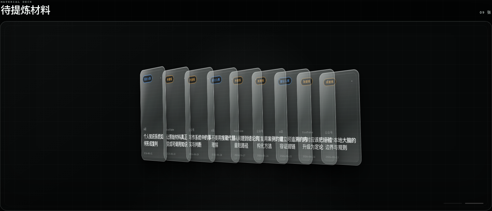
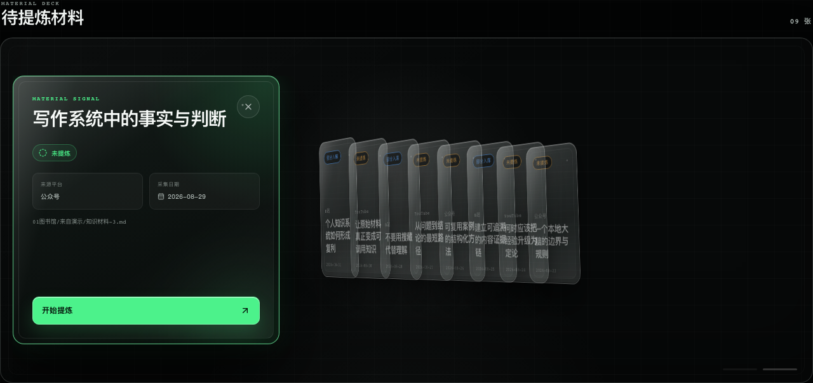
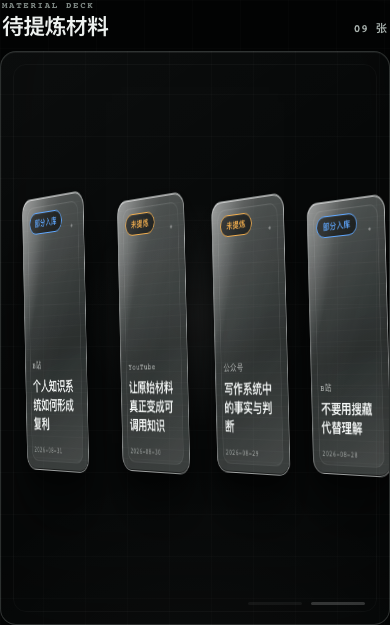

# 最佳拍档 · Best Partners

<p align="center">
  
</p>

<p align="center">
  <strong>每天的工作收得好，长期的知识找得到。</strong><br />
  面向 Apple Silicon Mac 的本地文件与知识工作台。<br />
  工作盘收纳日常文件，知识库积累可复用资料；需要时，从工作台找回并打开。
</p>

<p align="center">
  <a href="#开始使用">开始使用</a> ·
  <a href="#你可以用它做什么">核心能力</a> ·
  <a href="#界面预览">界面预览</a> ·
  <a href="docs/reference.md">使用参考</a> ·
  <a href="docs/development.md">开发文档</a>
</p>

为经常保存视频、录音、文案、网页和学习资料的人准备。最佳拍档将日常工作文件与长期知识分开：工作盘连接普通本地文件夹，按日期收纳新文件；知识库保留值得持续学习和复用的内容。

原始资料与知识笔记保存在本地文件夹中。你可以先整理和搜索；需要 AI 时，再配置自己的 DeepSeek 密钥并发起请求。当前为开发者预览阶段。

## 你可以用它做什么

| 你想完成的事 | 最佳拍档如何帮助你 |
| --- | --- |
| 下载后自动收好 | 在工作盘开启“自动收纳”，选择下载文件夹。接收所选文件夹及普通子文件夹中开启后新增的文件，等待写入稳定后按日期和类型保存副本；可暂停、继续、查看收纳记录和修改副本名称。 |
| 收好每天的工作文件 | 打开“工作盘”连接一个本地文件夹，选日期后收文件或直接写文案；开启“根据内容命名”后，文字资料可从正文生成名称，再进入日期和类型目录，原件保留，同名另存。 |
| 找回以前的工作资料 | 描述日期、类型和主题，查找真实文件名、路径与支持的文本正文；连接 AI 后可理解更多描述，未连接时仍可本地查找。 |
| 在工作台查看文件 | 日期浏览、类型筛选、文本和图片预览、常见音视频播放；其他格式可用系统应用打开。 |
| 收集分散的资料 | 用浏览器剪藏、导入 PDF / Markdown / TXT，或粘贴文本，把资料带进收件箱。 |
| 把读过的内容留下来 | 预览后归档原文与附件，再用 AI 生成可编辑的知识候选；由你决定保留、放弃或稍后处理。 |
| 找回知识的依据 | 搜索知识、查看关联来源，从一条结论回到原始资料。 |
| 围绕自己的资料提问 | 在“问问”里讨论当前资料或大脑中的知识，查看引用和本轮实际阅读范围。 |
| 读懂一句话并留下理解 | 在文章正文选中文字，点击“问问这段内容”，解释、追问后编辑保存为本机学习笔记。 |
| 在项目中创作内容 | 绑定项目文件夹，保存受众与表达风格，选择本条参考资料，先挑选 AI 选题再保存、编辑脚本；替换前保留版本，选题与脚本可回收/恢复，确认后导出到项目 `AI工作区`。 |
| 让外部助手查阅知识 | 单独配置只读 MCP，让 Codex 等支持 MCP 的工具搜索、阅读资料和来源证据。 |

Skill 自定义文件夹和项目选题、脚本支持多选、全选当前列表、一次确认批量回收、整批撤销与回收站多选恢复。失败项会单独说明并保留选择；已有导出文件保持原样。基础恢复边界见 [创作取舍与恢复验收](docs/reviews/2026-09-26-creation-recovery.md)，批量规则见 [批量回收设计](docs/superpowers/specs/2026-09-27-batch-recovery-design.md)。

“我的项目”直接使用已有文件夹，不搬走原文件。个人 MCP 需要单独配置；它只读文件，本身不调用模型。

工作盘与知识库使用独立目录；连接已有工作盘不会整理或移动旧文件。新收纳路径如 `2026-10-28/视频/采访.mp4`、`2026-10-28/文档/发布稿.md`。文本搜索目前支持 Markdown、TXT、CSV、JSON、字幕等；PDF、Office、图片和音视频按名称与路径查找。查找时 AI 只接收查找描述和日期，不接收整盘文件。详见 [工作盘验收](docs/reviews/2026-10-29-workdisk.md)。

导入时可开启“根据内容命名”：读取当前文件的 UTF-8 文本或 PDF 文字层，将可读正文交给设置中已连接的 AI，生成简短名称。图片先在本机读取文字与高置信画面类别，再将这些识别结果交给文字模型起名，原图不外发。单文件上限 20 MiB，长文只发送不超过 24,000 字符的开头、中间和结尾节选。新名称保留原扩展名，页面显示原名、实际保存名及原因；关闭开关则不为命名发送内容。扫描或加密 PDF、Office、音视频、识别证据不足、AI 未连接或失败时沿用原名。这一步只命名本次导入的副本，不改已有文件。文字链路见 [内容命名验收](docs/reviews/2026-10-29-content-naming.md)，图片与自动接收见 [自动收纳验收](docs/reviews/2026-10-30-auto-collection.md)及[子文件夹漏接修复](docs/reviews/2026-10-30-auto-collection-subfolders.md)。

自动收纳在桌面应用运行时后台工作，不必停留在工作盘页面。接收目录应独立于工作盘和知识库，浏览器或微信需要实际将文件保存到这个目录；应用不会接管第三方的保存弹窗。首次启用记住所选目录及普通子目录里的现有文件，仅处理后来出现的新文件，暂停或退出期间的新文件会在继续或下次启动时补收。工作盘硬盘暂时断开时保留开启状态并等待；同一硬盘和目录恢复后继续收纳。首次记住稳定磁盘身份之前，旧版连接可能需要重新选择原工作盘一次。旧版升级到子文件夹接收时，先登记子文件夹中的既有文件，不批量处理历史下载；此前漏接的文件可用“收文件”补收。原始下载保留，常见临时下载后缀、隐藏项目、应用包和链接跳过；最近 50 条结果可查看或展开。处理前写入记录防止重启重复，遇到中断且无法确认结果时提示核对，不自动重复复制。历史去重记录达到 10,000 条时停止自动接收并提示，避免丢失去重历史。硬盘重连与恢复验证见 [移动硬盘重连修复](docs/reviews/2026-10-30-workdisk-reconnect.md)。

## 从资料到知识，再到项目


AI 提炼得到的是草稿。你可以修改内容、检查来源、选择保留项，再预览并确认写入知识库。普通问答不会自动把回答写成知识。

## 界面预览

材料卡片把待处理资料放在一起，打开后可查看来源和内容。以下为仓库已有的隔离测试界面示例；具体页面以所用版本为准。

<p align="center">
  
</p>

<details>
<summary>查看材料详情与窄窗口示例</summary>

<p align="center">
  
</p>

<p align="center">
  
</p>

截图使用隔离测试资料。

</details>

## 开始使用

### 选择一个版本

- **试用已发布的预览包**：[下载 Apple Silicon 预览版](https://github.com/zhouao010809-code/best-partners/releases/latest)。当前预览包尚未完成 Developer ID 签名和 Apple 公证，请先阅读 Release 安装说明。
- **运行最新源码**：本页功能说明对应 `main`，已发布的预览包不包含之后的全部改动。体验最新实现可按下方命令运行。

需要 Apple Silicon Mac、Node.js 22.22.3+ 和 Xcode Command Line Tools。

```sh
git clone https://github.com/zhouao010809-code/best-partners.git
cd best-partners
npm ci
npm run electron
```

### 从第一份资料开始

1. **创建或选择“我的大脑”**：这是保存资料和知识的本地文件夹；新建时会提供初始目录和规则模板。
2. **带进一份资料**：在收件箱导入文件或粘贴文本，核对信息后归档。浏览器剪藏插件可稍后在「设置 → 浏览器收藏」配置，收件箱也提供直达入口。
3. **生成知识草稿**：需要 AI 时，在设置中保存自己的 DeepSeek 密钥；进入提炼队列，预览发送内容并确认提炼。
4. **留下真正有用的内容**：编辑候选、核对来源，预览本批变化后确认入库；随后在知识库搜索，也可在项目问答中检索。

“收件箱”存放待整理资料；“提炼”生成可编辑草稿；“入库”是你确认后保存为知识笔记。

## 文件、AI 与使用边界

- **本地保存**：原文和知识笔记以本地文件保存；索引、对话及草稿保存在本机。桌面版直接读取大脑文件夹，无需启动 Obsidian 或其 Local REST 插件。
- **按需使用 AI**：AI 问答与提炼调用 DeepSeek，相关内容会发送给服务商，并可能产生费用。保存密钥、浏览资料和预览提炼本身不会调用模型。
- **写入由你决定**：归档、知识入库和项目产出保留确认步骤；归档与入库保留原文正文。回收站支持恢复，彻底删除需逐项确认。
- **格式范围明确**：支持 PDF / Markdown / TXT。PDF 读取文字层，暂不支持 OCR、图片问答和 DOCX 解析。

文件大小、发送范围、恢复记录与冲突处理详见 [功能与使用参考](docs/reference.md)。

## 开发与文档

桌面端使用 Electron + React + TypeScript，服务端使用 Fastify，SQLite 保存索引和操作状态。原始资料与附件保存在本地文件夹，知识笔记使用 Markdown。

| 你要了解的内容 | 入口 |
| --- | --- |
| 详细操作、文件限制、个人 MCP 与数据位置 | [功能与使用参考](docs/reference.md) |
| 本地开发、测试与打包 | [开发与验证](docs/development.md) |
| 当前架构与本地收口结果 | [2026-09-25 验收报告](docs/reviews/2026-09-25-architecture-foundation-acceptance.md) |
| 首次使用流程及验证范围 | [首次使用走查](docs/reviews/2026-09-11-first-run-walkthrough.md) |
| 安装包、剪藏插件与分发状态 | [分发验收](docs/reviews/2026-09-14-distribution-acceptance.md) |
| 独立公司工作区的部署与操作 | [公司工作区运行手册](docs/company/company-p0-operations.md) |

公司工作区是独立运行模式，使用单独的数据与账号；个人桌面版无需配置公司模式或提供平台导出报表。

日常改动可运行 `npm run verify:fast`；完整验证和发布流程分别使用 `npm run verify:full` 与 `npm run verify:release`，环境要求与具体覆盖见开发文档。

## 许可

本仓库公开展示源码，采用保留所有权利的授权方式，并非开源许可证。使用、修改和分发条件以 [LICENSE](LICENSE) 为准。
