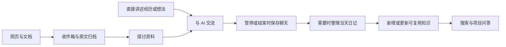
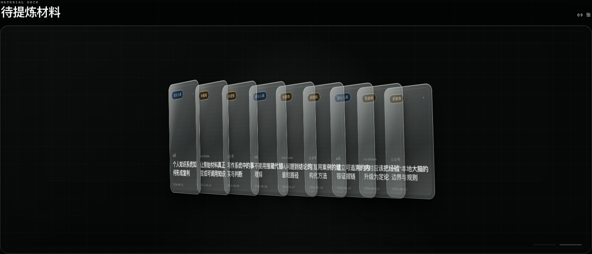
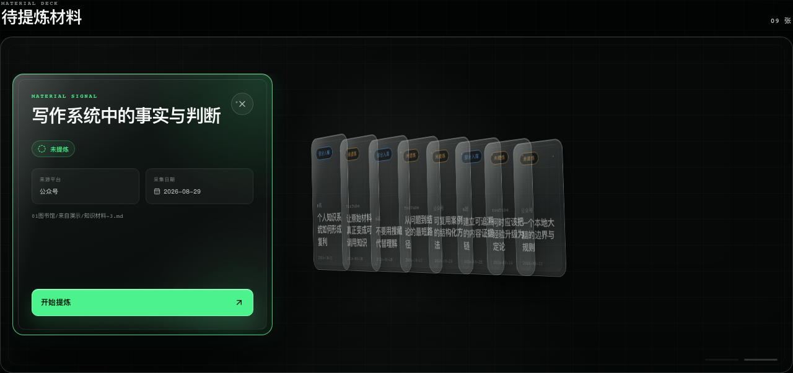
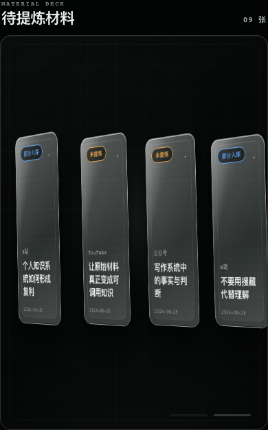

# 最佳拍档 · Best Partners

<p align="center">
  
</p>

<p align="center">
  <strong>把收藏的资料，变成做事时用得上的知识。</strong><br />
  面向 Apple Silicon Mac 的本地知识与项目助手。<br />
  收集网页和文档，结合自己的思考整理知识，再把积累带回项目中使用。
</p>

<p align="center">
  <a href="#开始使用">开始使用</a> ·
  <a href="#你可以用它做什么">核心能力</a> ·
  <a href="#界面预览">界面预览</a> ·
  <a href="docs/reference.md">使用参考</a> ·
  <a href="docs/development.md">开发文档</a>
</p>

为经常收集网页、阅读文档、撰写内容或推进客户项目的人准备。最佳拍档把资料收集、知识整理和项目问答连在一起，让你在下一次写作、讨论或做方案时，能找到相关知识，也能回到它的原始出处。

原始资料与知识笔记保存在本地文件夹中。你可以先整理和搜索；需要 AI 时，再配置自己的 DeepSeek 密钥并发起请求。当前为开发者预览阶段。

## 你可以用它做什么

| 你想完成的事 | 最佳拍档如何帮助你 |
| --- | --- |
| 收集分散的资料 | 用浏览器剪藏、导入 PDF / Markdown / TXT，或粘贴文本，把资料带进收件箱。 |
| 把读过的内容留下来 | 在新版小兆大脑中，围绕资料探讨，保存日记，从自己的思考中积累可复用知识。 |
| 找回知识的依据 | 搜索知识、查看关联来源，从一条结论回到原始资料。 |
| 围绕自己的资料提问 | 在“问问”里讨论当前资料或大脑中的知识，查看引用和本轮实际阅读范围。 |
| 在项目中创作内容 | 绑定项目文件夹，保存受众与表达风格，选择本条参考资料，先挑选 AI 选题再保存、编辑脚本；替换前保留版本，选题与脚本可回收/恢复，确认后导出到项目 `AI工作区`。 |
| 让外部助手查阅知识 | 单独配置只读 MCP，让 Codex 等支持 MCP 的工具搜索、阅读资料和来源证据。 |

Skill 自定义文件夹和项目选题、脚本支持多选、全选当前列表、一次确认批量回收、整批撤销与回收站多选恢复。失败项会单独说明并保留选择；已有导出文件保持原样。基础恢复边界见 [创作取舍与恢复验收](docs/reviews/2026-09-26-creation-recovery.md)，批量规则见 [批量回收设计](docs/superpowers/specs/2026-09-27-batch-recovery-design.md)。

「我的项目」以表格显示项目名、品类、品牌定位和购买理由。点项目名进入创作工作区，点品牌定位可编辑该项目的品牌资料，分别维护证据链和核心宣传主张。品牌资料保存在本机，项目文件夹中的原文保留在原处。个人 MCP 需要单独配置；它只读文件，本身不调用模型。

## 从资料到知识，再到项目



新版库首页的「待探讨资料」显示未探讨和部分探讨完成的资料。暂停或结束时可确认或调整建议进度。确认「全面探讨完成」后，资料退出首页，仍可在档案库回看，也可在「探讨」中再次选用。整理日记后，有合适的知识才保存到 `03知识库`。

## 界面预览

材料卡片把待处理资料放在一起，打开后可查看来源和内容。以下为仓库已有的隔离测试界面示例；具体页面以所用版本为准。

<p align="center">
  
</p>

<details>
<summary>查看材料详情与窄窗口示例</summary>

<p align="center">
  
</p>

<p align="center">
  
</p>

截图使用隔离测试资料。

</details>

## 开始使用

### 选择一个版本

- **试用已发布的预览包**：[下载 Apple Silicon 预览版](https://github.com/zhouao010809-code/best-partners/releases/latest)。当前预览包尚未完成 Developer ID 签名和 Apple 公证，请先阅读 Release 安装说明。
- **运行最新源码**：本页功能说明对应 `main`，已发布的预览包不包含之后的全部改动。体验最新实现可按下方命令运行。

需要 Apple Silicon Mac、Node.js 22.22.3+ 和 Xcode Command Line Tools。

```sh
git clone https://github.com/zhouao010809-code/best-partners.git
cd best-partners
npm ci
npm run electron
```

### 从第一份资料开始

1. **创建或选择“我的大脑”**：这是保存资料和知识的本地文件夹；新建时会提供初始目录和规则模板。
2. **带进一份资料**：在收件箱导入文件或粘贴文本，核对信息后归档。浏览器剪藏插件可稍后在「设置 → 浏览器收藏」配置，收件箱也提供直达入口。
3. **开始交流**。连接新版小兆大脑时，在设置中保存 DeepSeek 密钥，再从「探讨」选择资料或直接说出自己的想法。
4. **整理日记**。暂停后可以回来接着聊。需要整理时，保存当天日记并查看本次整理出的知识。

连接旧格式「我的大脑」时，仍通过提炼队列生成候选，经审阅确认后入库。

## 文件、AI 与使用边界

- **本地保存**：原文和知识笔记以本地文件保存；索引、对话及草稿保存在本机。桌面版直接读取大脑文件夹，无需启动 Obsidian 或其 Local REST 插件。
- **按需使用 AI**：AI 问答、探讨和日记整理调用 DeepSeek，相关内容会发送给服务商，并可能产生费用。保存密钥、浏览资料和预览提炼本身不会调用模型。
- **写入由你决定**：你发起整理日记后，应用保存日记及可复用知识并回填关联。资料探讨进度经你确认后更新。回收站支持恢复，彻底删除需逐项确认。
- **格式范围明确**：支持 PDF / Markdown / TXT。PDF 读取文字层，暂不支持 OCR、图片问答和 DOCX 解析。

文件大小、发送范围、恢复记录与冲突处理详见 [功能与使用参考](docs/reference.md)。

## 开发与文档

桌面端使用 Electron + React + TypeScript，服务端使用 Fastify，SQLite 保存索引和操作状态。原始资料与附件保存在本地文件夹，知识笔记使用 Markdown。

| 你要了解的内容 | 入口 |
| --- | --- |
| 详细操作、文件限制、个人 MCP 与数据位置 | [功能与使用参考](docs/reference.md) |
| 本地开发、测试与打包 | [开发与验证](docs/development.md) |
| 当前架构与本地收口结果 | [2026-09-25 验收报告](docs/reviews/2026-09-25-architecture-foundation-acceptance.md) |
| 首次使用流程及验证范围 | [首次使用走查](docs/reviews/2026-09-11-first-run-walkthrough.md) |
| 安装包、剪藏插件与分发状态 | [分发验收](docs/reviews/2026-09-14-distribution-acceptance.md) |
| 独立公司工作区的部署与操作 | [公司工作区运行手册](docs/company/company-p0-operations.md) |

公司工作区是独立运行模式，使用单独的数据与账号；个人桌面版无需配置公司模式或提供平台导出报表。

日常改动可运行 `npm run verify:fast`；完整验证和发布流程分别使用 `npm run verify:full` 与 `npm run verify:release`，环境要求与具体覆盖见开发文档。

## 许可

本仓库公开展示源码，采用保留所有权利的授权方式，并非开源许可证。使用、修改和分发条件以 [LICENSE](LICENSE) 为准。
