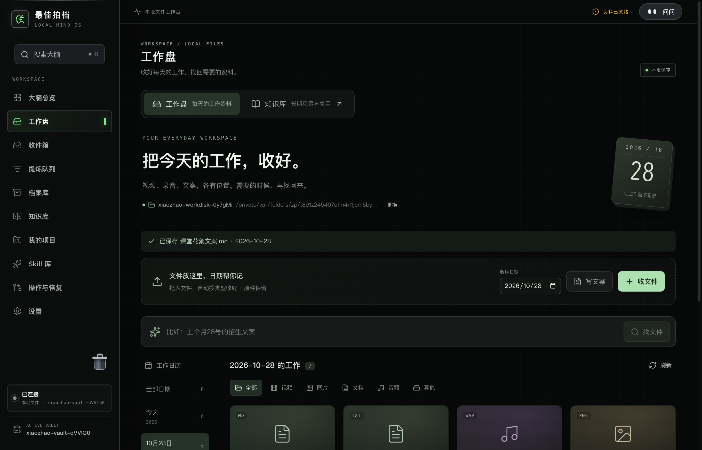
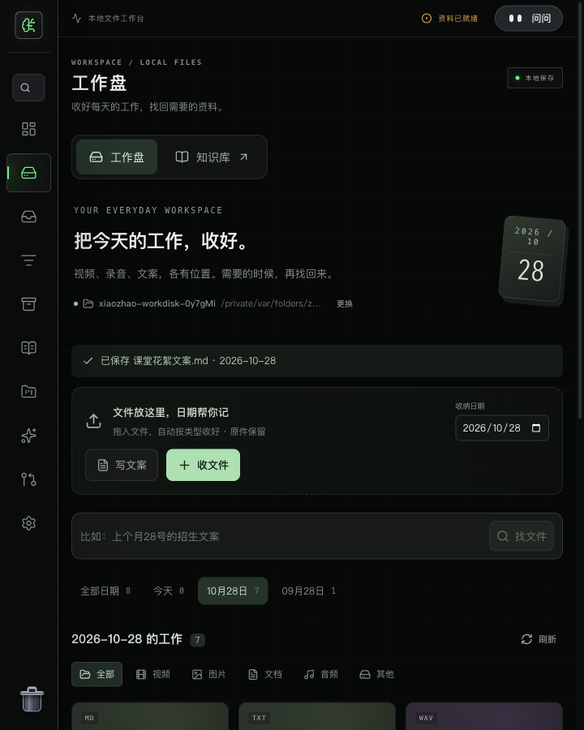

# 工作盘验收 · 2026-10-29

本轮依据用户确认的需求，在 `desktop-read` 现有骨架上增加独立工作盘。用户日常工作文件与长期知识资料分开，文件继续保存在普通本地目录。本记录是隔离自动化与代码复核证据，不是用户研究。

## 已观察

- 左侧“工作盘”打开独立页面；页面可直接前往“知识库”。连接普通目录后显示原有文件，目录结构未被重组。
- 指定收纳日期后导入图片、录音、文案，真实写入 `YYYY-MM-DD/图片、音频、文档`。导入使用复制，同名文件追加编号，原件和旧文件字节不变。
- 页面直接写文案，保存为日期目录下的 Markdown 文件。保存失败保留输入；会话内收起、重新打开可恢复临时草稿。临时草稿没有宣称跨应用重启恢复。
- 文本与图片可在工作盘内预览，音频使用受限本地协议流式播放；媒体控制器测试验证字节范围请求、非法凭证和切换工作盘时旧凭证失效。
- “2026年9月28号的招生文案”可找到名字不含“招生”、但正文包含该词的旧文件，结果显示正文匹配片段及实际路径。退出搜索返回普通文件浏览。
- 未配置 AI 仍能解析明确日期、文件类型与主题关键词；模型测试验证只提交查询和用户本地日期，无文件正文、无工具。模型失败、超时或格式错误时回到本地查找并说明原因。
- 重启开发版与打包版后，工作盘连接、导入文件及保存文案仍可读取；知识目录哨兵保持原样。
- 720px 窗口无整页横向溢出。日历在窄窗口改为横向日期条，收纳操作换行。
- 不支持硬链接时的独占复制，通过模拟 ENOTSUP/EPERM 的真实文件测试验证；同名避让与部分写入失败清理均通过。

## 验证结果

| 验证 | 结果 |
| --- | --- |
| 架构边界、五个 TypeScript 目标、客户端构建大小检查 | 通过 |
| 单元测试全量 | 108 个文件，1,310 项通过 |
| 工作盘存储与查询集成测试 | 24 项通过 |
| 工作盘桌面控制器 | 11 项通过，包含异步切盘回归 |
| 工作盘组件、导航与既有资料牌堆复查 | 105 项通过，其中工作盘 8 项 |
| 个人 MCP / 公司 MCP | 25 / 13 项通过 |
| Electron 工作盘开发版 / 打包版 | 2 项通过 |
| Electron 首次使用开发版 / 打包版，空大脑 / 待处理资料 | 4 项通过 |
| Electron 划选问问开发版 / 打包版 | 2 项通过 |
| 当前源码构建与打包校验 | 通过，sourceSha256 `b2bf3aecba0f0c5829820407d5c0b3b950456d61f605522c3dff62f678f5ef59` |

开发过程的全量组件测试曾出现导航数量旧断言及已有牌堆超时；导航断言已随新入口更新，三组相关测试定向复跑 105/105，并补充工作盘显示“本地保存”而非“只读”的回归。全量集成测试与新增红绿回归并行时捕获两项修复前失败；存储、查询修复后的 24 项已单独复跑通过。没有将先前运行表述为一次全绿。

## 当前边界

- 单次扫描最多 10,000 目录项、返回 2,000 文件；文本每文件最多读取 512 KiB，一次搜索正文最多 32 MiB。界面提示截断与未完整读取，不能把部分结果当成完整全盘检索。
- PDF、Office、图片、视频、录音目前按文件名及路径搜索；未做 OCR、转写或音画内容理解。AI 主要扩展查询条件，实际匹配仍在本地进行。
- 内置图片预览最多 8 MiB；PDF 和不支持的媒体编码交给系统应用。视频协议实现及范围请求已测试，GUI 实际播放覆盖 WAV；其他编码不是逐个实测。
- 原生系统选择框在自动化中使用受控测试输入。真实拖放、真实 AI 账号质量、实体 exFAT 外置盘、磁盘拔出或断电恢复尚未实际验收。
- 无硬链接文件系统的备用保存方式是独占复制，正常错误会清理自己的不完整文件、退出会等待写入；没有承诺突然断电时的单步原子发布。
- 本轮没有删除、覆盖、迁移用户真实资料，也没有安装到 `/Applications` 或公开分发。既有知识提炼、项目及外部只读 MCP 功能继续保留。

## 界面





## 复现

```sh
npx vitest run --config vitest.integration.config.ts tests/integration/workdisk-service.test.ts tests/integration/workdisk-search.test.ts
npx vitest run tests/unit/workdisk-desktop.test.ts
npx vitest run --config vitest.client.config.ts tests/component/workdisk-page.test.tsx tests/component/app-shell.test.tsx tests/component/material-deck/MaterialDeck.test.tsx --maxWorkers=1
npm run build:desktop-runtime
npm run package:mac:built
npx playwright test --config playwright.electron.config.ts tests/electron/workdisk.test.ts tests/electron/first-run-walkthrough.test.ts tests/electron/reading-assistant.test.ts
```

本次调用依据与来源方法对应见 [实施计划](../plans/2026-10-29-workdisk-implementation.md)。
