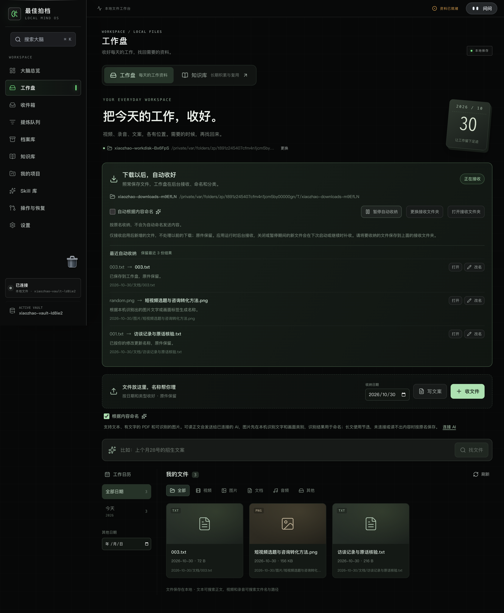
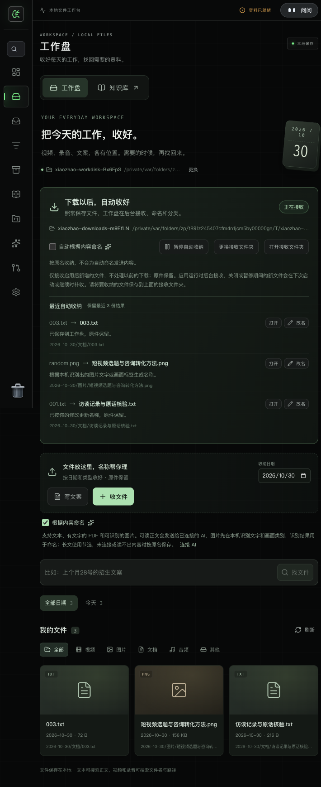

# 自动收纳与图片命名验收 · 2026-10-30

最终构建与打包完成，开发版和打包版共 10 条桌面流程回归全部通过。已在本机最终打包应用中通过原生选择框开启 Downloads 自动收纳，并保留原工作盘连接。

用户已批准将保存到电脑“下载”目录的新文件自动接收进工作盘：读取支持的内容、生成可读名称、按日期和类型保存副本，并允许收纳后手动调整副本名称。原始下载保留，知识库仍使用独立目录。具体范围见[实施计划](../plans/2026-10-30-auto-collection.md)。本记录不是用户研究，也不是对真实 AI 账号或标题质量的评估。

## 证据分层

| 标记 | 本文含义 |
| --- | --- |
| 已观察 | 本轮实际执行并取得结果的检查；同时注明隔离范围。 |
| 代码复核 / 设计推断 | 从当前源码与测试断言确认的行为或预期，仍需最终运行验证。 |
| 待验证 | 尚未取得本轮最终结果，不引用上一轮结果代替。 |

## 已观察

- 真实临时文件验证自动收纳基线、至少 3 秒稳定等待、原件保留、持久去重、暂停恢复、退出、目录替换和异常中断处理；自动收纳与存储共 **55 项通过**。
- 图片与既有文字命名集成共 **17 项通过**。使用合成图像及真实本机 ImageIO / Vision，覆盖支持格式的解码、OCR、证据不足、超限和取消；模型只接收提取文字、标签和节选标记。
- 桌面控制器、构建来源及打包内容共 **44 项通过**。其中控制器 24 项覆盖严格参数校验、目录选择取消、并发选择阻断、启停、命名开关、改名和接收目录验证。
- 自动收纳及工作盘组件共 **22 项通过**，覆盖外发说明、开关、回执、改名草稿、结果展开及后台收纳与搜索刷新互不覆盖。
- 首轮完整桌面检查发现命名复选框需等后台保存后才反映操作。延迟保存回归先失败再通过；当前复选框即时响应，保存期间明确提示尚未生效，失败恢复旧选择。后台采用先保存再更新命名状态；两方向落盘失败和恢复接收失败共 3 项回归先失败再通过。
- 独立复核还促成了副本身份核对、无硬链接文件系统的独占复制回退、安静轮询不重复写记录，以及迟到轮询不覆盖操作结果等修正。最终结果由主线程实际检查和合并验证。

最终 Electron 和本机真实启用结果见下表及后文；隔离测试不代表真实 AI 标题质量。

## 当前实现范围与边界

以下为当前源码复核结果；端到端观察以最终测试结果为准。

### 接收哪些文件

- 先连接工作盘，再由用户通过原生选择框选择接收目录；选择框默认定位电脑的 Downloads。接收目录必须与工作盘、知识库、应用设置目录分离，禁止相互包含和符号链接根目录，防止循环收纳。
- 首次连接一个接收目录时，为其中已有普通文件建立基线；只收纳后来出现的新文件。旧下载不会因后续修改而变成新文件，也不会重新分类、移动或批量改名。
- 只扫描接收目录第一层，不递归子文件夹。隐藏文件、链接、文件夹、空文件和常见未完成下载后缀跳过，例如 `.crdownload`、`.part`、`.download`、`.tmp`。下载完成并改为普通文件名后，再进入候选检查。
- 文件需要多次检查大小与时间信息稳定，且稳定时间至少 3 秒，才会开始收纳。命名和复制过程中继续校验来源。该判断不能保证所有下载软件都遵守相同的写入协议，因此原件始终保留，失败或不确定结果可查看。
- 微信或浏览器必须实际把文件保存到所选目录。应用不接管第三方保存弹窗，不访问微信内部缓存，不把尚未保存到接收目录的附件算作已接收。

### 保存、命名与外发

- 工作盘保存的是副本，目录由本地规则决定：`收纳当天的本地日期/文件类型/文件名.原扩展名`。例如 `2026-10-30/文档/访谈证据记录方法.txt`；补收使用执行收纳时的日期，不按文件最初下载日期回填。
- 文件类型依扩展名进入视频、音频、图片、文档或其他目录，不让模型选择任意路径。自动命名只作用于本次新副本；导入时同名另存，避免覆盖已有文件。
- 自动收纳与手动收文件有各自的命名开关。开启自动命名时，界面和原生选择说明会告知：提取的文字、图片识别结果会交给设置中已连接的 AI。关闭后仍按日期和类型收纳，以原名保存，不为命名发送内容。
- 文字命名沿用 UTF-8 文本与 PDF 文字层解析。单文件内容命名上限 20 MiB，长文按开头、中间、结尾抽取，最多发送 24,000 字符；回执说明是否使用节选。
- 图片命名支持 JPEG、PNG、WebP、HEIC、HEIF、TIFF、BMP 对应扩展名。原图在本机解码，通过 Vision 读取文字与高置信度画面类别，再把这些文字证据交给文字模型。原图二进制、文件名、目录和元数据不作为模型输入。
- 图片识别限制为单边不超过 30,000 像素、总像素不超过 1 亿；解码为最长边 3,000 像素的缩略图。多帧图像只使用首帧，缩小、截断或部分识别会标记为部分证据。原生进程默认 15 秒超时，整次内容命名默认 30 秒超时；取消会终止本机识别子进程。
- 视觉类别和 OCR 是命名依据，不代表已完整理解图片。提示要求不猜测人物身份或其他未经证据支持的信息。识别不足、组件不可用、模型未连接、超时或返回名称不合规时，保留原名并显示原因。
- 扫描或加密 PDF、Office 文档、音视频暂不做正文 OCR 或转写；GIF、AVIF、SVG 等不在本轮图片命名格式集合内。它们仍可按原名收纳，不将“图片可预览”视为“图片一定可识别”。

### 暂停、关闭与恢复

- 后台接收运行在桌面主进程，不要求一直停留在工作盘页面；应用关闭时不持续监视目录。已启用状态会持久化，关闭期间新增文件在下次启动补收；暂停期间新增文件在继续后补收。
- 暂停或关闭会取消当前 AI 等待，不再启动下一份文件；已经开始的本地复制收尾后再完成暂停或退出。剩余候选保留给后续继续或启动，不强行跑完整批 AI 请求。
- 去重记录按文件身份持久化，已处理的同一文件不会因轮询或重启再次复制；本功能不是对原文件后续编辑的持续同步。
- 复制前先持久化“处理中”记录。若进程中断导致结果无法确认，恢复后显示“需核对”，不自动重放；失败项也记录一次并提示手动核对或收纳，避免反复产生副本。
- 接收目录身份变化、工作盘绑定或实际目录变化、记录损坏、目录不可用时暂停并反馈。更换工作盘前先停止自动接收；重新选择接收目录后才确认新的目标。
- 最近结果保留 50 条，界面可展开查看。持久去重记录不因结果列表截断而删除；达到 10,000 条记录、扫描项目上限或记录大小上限时停止接收并说明原因，不通过丢失去重历史继续运行。

### 收纳后修改副本名称

- 最近收纳记录提供“改名”，只修改工作盘副本；原下载的名称、位置、正文和字节保持不变。原扩展名、日期和类型目录保留。
- 标题经过规范化，最多 60 个字符、180 字节；拒绝目录、路径字符、扩展名、特殊控制字符及保留名称。同名目标直接拒绝，不覆盖。
- 收纳时持久化副本的设备、文件标识和创建时间信息；改名前核对该身份以及当前工作盘绑定。若原副本被移走、旧路径出现另一个文件，旧收纳记录不能给替代文件改名。
- 改名成功更新实际路径和收纳记录；失败保留输入供用户调整。该入口不构成任意路径文件管理或批量改名授权。

## 回归范围与结果登记

| 层级 / 入口 | 本轮结果 |
| --- | --- |
| 自动收纳、工作盘存储、命名存储集成 | 55 项通过，含保存失败不改变命名设置、启用失败保持暂停 |
| 本机图片证据、文字内容命名集成 | 17 项通过 |
| 桌面控制器、构建来源、打包内容 | 44 项通过 |
| 自动收纳与工作盘组件 | 22 项通过 |
| Electron 自动收纳，开发版 / 打包版 | 2 项通过 |
| Electron 手动命名与既有工作盘，开发版 / 打包版 | 4 项通过 |
| Electron 首次使用，空大脑 / 待处理资料及开发 / 打包 | 4 项通过 |
| 架构边界、五个 TypeScript 目标、客户端体积 | 通过 |
| 最终桌面构建、macOS arm64 打包与来源校验 | 通过；sourceSha256：`46c02059c9cce092ed3f6b7b086434894fdba634ccdabcfb79bd9bc870be6bb4` |

新增 Electron 场景使用独立临时大脑、`userData`、工作盘和接收目录，固定假密钥，并拦截模型网络：

1. 在启用前放置 `old.txt` 建立基线；启用后放入 `.crdownload`，等待超过稳定窗口仍不收纳，改为 `001.txt` 后读取真实正文生成名称。
2. 切换到设置页后，把真实合成 PNG 保存到接收目录，验证主进程仍能识别像素、命名并保存；返回工作盘查看结果。
3. 核对请求只有正文或图片文字/标签，无源文件名、目录、原图或 Base64；模型结果采用固定 JSON，不声称真实标题质量已验证。
4. 通过界面修改副本名称，核对新路径、原副本路径消失、下载原件字节不变。
5. 暂停后新增文件不收纳；关闭自动命名再继续，新增文件按原名补收且不新增模型请求。
6. 关闭应用后新增文件，再次启动补收；已有路径与文件数保持一致，旧下载不复制，知识库哨兵不变。
7. 记录宽窗口与 720px 截图，核对页面和自动收纳区域没有横向溢出。





## 真实 Downloads 启用与发布边界

- 用户已明确选择电脑 Downloads；最终 0.1.8 打包应用通过真实原生选择框选中 `/Users/ao/Downloads`，返回工作盘后显示“正在接收”，“自动根据内容命名”已选中。当前工作盘保持 `/Volumes/小兆滴剪辑盘/项目/黑骏画室working`，大脑保持 `/Users/ao/我的大脑`。
- 开启前后工作盘均显示原有 3 份文件，自动收纳结果为空；没有使用历史下载做测试，没有手工放入真实下载测试文件。应用已保持开启并停留在工作盘页。**已开启，真实微信/浏览器新下载收纳尚未验证。**
- 真实设置页显示 AI 密钥已保存、连接尚未验证；本轮没有触发真实模型请求，没有验证真实账户的可用性、命名质量或耗时。模型不可用时仍保留原名收纳，并显示原因。
- 冷启动首次首页读取曾显示暂时失败；随后索引就绪，重新进入首页已正常展示，工作盘和设置页均可读。未将该瞬时现象归因于本次功能，也未据此修改其他模块。
- 原生选择框已真实执行；真人对术语理解、微信或浏览器实际下载协议、断盘重连体验仍需后续观察。3 秒静默检测不是第三方软件的“下载已完成”保证。
- Apple Silicon macOS 为当前目标。原生图片组件已列入构建、打包白名单和来源清单，隔离打包版已通过实际像素识别流程。未执行签名、公证或公开发布，当前仍为本机开发预览。

## 复现入口

应先构建原生组件；完整 Electron 回归必须使用本轮最终构建和打包产物，不运行旧产物后给新功能记通过。

```sh
npm run build:native
npx vitest run --config vitest.integration.config.ts tests/integration/workdisk-auto-collector.test.ts tests/integration/workdisk-image-evidence.test.ts tests/integration/workdisk-content-namer.test.ts tests/integration/workdisk-naming-storage.test.ts tests/integration/workdisk-service.test.ts
npx vitest run --config vitest.config.ts tests/unit/workdisk-auto-desktop.test.ts tests/unit/workdisk-desktop.test.ts tests/unit/build-provenance.test.ts tests/unit/package-content.test.ts
npx vitest run --config vitest.client.config.ts tests/component/workdisk-auto.test.tsx tests/component/workdisk-page.test.tsx
npm run check:architecture
npm run build:desktop-runtime
npm run package:mac:built
npx playwright test --config playwright.electron.config.ts tests/electron/workdisk-auto.test.ts
npx playwright test --config playwright.electron.config.ts tests/electron/workdisk-naming.test.ts tests/electron/workdisk.test.ts tests/electron/first-run-walkthrough.test.ts
```

本次调用依据：[实施计划](../plans/2026-10-30-auto-collection.md)中已确认的新增接收、原件保留和副本改名范围用于验收边界；[首次使用复查规则](2026-09-11-first-run-walkthrough.md#后续加功能时的复查规则)用于入口、外发说明、失败恢复及隔离回归；[分发验收](2026-09-14-distribution-acceptance.md)用于区分已观察、设计推断与未验证；当前自动收纳、图片识别、存储源码及对应测试用于列明实际机制和待核验断言。
